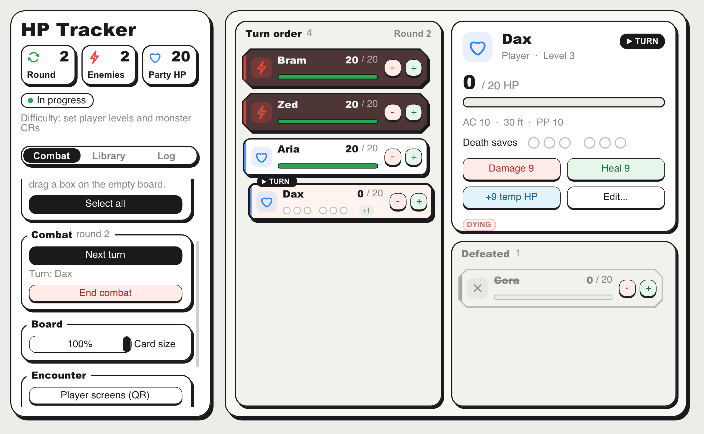

# DnD HP Tracker

> ### ⬇ Download — version 2.1.1
> **[Windows](Downloads/Windows/)** (10 or 11) · **[Mac](Downloads/Mac/)** (Apple Silicon, M1 or newer)
>
> Each link opens a page with the download and how to open the app the first time.
> All versions: the [Downloads](Downloads/) folder.

A combat tracker for Dungeons & Dragons 5e Dungeon Masters. Set up the party and
the monsters as cards in a **turn order** you arrange by hand, press **Start
combat**, and pass the turn with one click; rounds count themselves. The tracker
handles hit points, temporary HP, resistances, conditions, concentration checks,
death saves and encounter difficulty, so you can focus on running the fight.

There are no initiative numbers: you drag the cards into the order your table
agreed on, and the tracker follows it.



---

## Contents

- [Quick start](#quick-start)
- [The screen](#the-screen)
- [Reading a card](#reading-a-card)
- [Dealing damage and healing](#dealing-damage-and-healing)
- [Selecting several creatures (area effects)](#selecting-several-creatures-area-effects)
- [Conditions and rounds](#conditions-and-rounds)
- [Concentration](#concentration)
- [Dropping to 0 HP and death saves](#dropping-to-0-hp-and-death-saves)
- [Editing a creature](#editing-a-creature)
- [Adding creatures and the monster library](#adding-creatures-and-the-monster-library)
- [Encounter summary and difficulty](#encounter-summary-and-difficulty)
- [Alerts and the combat log](#alerts-and-the-combat-log)
- [Player screens (phones)](#player-screens-phones)
- [The turn order](#the-turn-order)
- [Undo, saving and starting over](#undo-saving-and-starting-over)
- [Keyboard and mouse reference](#keyboard-and-mouse-reference)
- [Rules the tracker applies](#rules-the-tracker-applies)
- [Building, packaging and tests](#building-packaging-and-tests)
- [Project layout](#project-layout)

---

## Quick start

1. Open **DnD HP Tracker.app**. The first time on a new Mac, right-click it and choose
   **Open**, because the app isn't signed by a paid Apple developer account.
2. On first launch you get a sample Hero, Goblin and Orc. Delete them with a right-click
   > **Delete** (or select them and press Delete), or use **New encounter > Remove everything**.
3. **Set up:** right-click the list and choose **New character...** to add your party
   and monsters (or **Add from library**). Drag the cards into turn order. Tick
   **Also save to the party** for your players: next time **Add the party** brings
   them all back in one click.
4. Press **Start combat**. Type an amount (e.g. `8`) in the **Amount** box and press
   **-** (damage) or **+** (heal) on a card, or the big buttons in the spotlight.
   Press **Next turn** (or Space) to pass the turn; after the last card a new round
   starts by itself.
5. Press **End combat** when the fight is over: the enemies leave, the party stays.

Everything autosaves, so closing the app never loses the fight.

---

## The screen

**Left: the sidebar**

- **Summary** (always visible)
  - Three tiles: the round number, how many enemies are still standing, and
    the party's total HP (hover a tile for details).
  - The encounter status: *In progress*, *Enemies defeated*, *Party down!*,
    *Party defeated* or *Encounter over*.
  - The encounter difficulty.
- **Combat** tab
  - The damage/heal amount.
  - Actions for the selected creatures.
  - Before combat: Start combat. In combat: Next turn, the round, End combat.
  - Card size.
  - Encounter controls, save/load and undo/redo.
- **Library** tab: your saved party and the monster library.
- **Log** tab: everything that happened, round by round.

**Right: the board**

- **Turn order** (left): everyone still in the fight, top to bottom, as compact
  cards. The card that holds the turn steps forward and wears a black **TURN** ribbon.
- **Spotlight** (top right): in combat, one card shown big (the one whose turn it is,
  or the last card you clicked) with its stats, death saves, conditions, notes and
  action buttons. Before combat, the setup panel with **Start combat**.
- **Defeated** (bottom right): enemies at 0 HP and players who have died. Cards fall
  here by themselves.
- Alerts pop up in the bottom-right corner.

---

## Reading a card

Each card in the lists is a compact row:

| Part | Meaning |
|---|---|
| Icon tile | Blue heart = player, red bolt = enemy, gray X = dead |
| Name | Struck through when dead |
| `35 / 40 +5` | Current / max HP, and temporary HP in blue |
| HP bar | Green above 50%, amber above 25%, red below |
| Six circles | Death saves: 3 successes (green) and 3 failures (red), in place of the bar for players at 0 HP |
| Chips next to the bar | Status at a glance (see below) |
| **-** / **+** | Damage / heal this creature by the current amount |

Click a card to see it in the **spotlight**, which shows everything at full size:
big HP and bar, AC, speed and passive Perception, resistances, CR and XP or level,
death saves, all its chips, notes, and buttons for **Damage**, **Heal**, **+temp HP**
and **Edit...**.

**Chips:**

| Chip | Meaning |
|---|---|
| `DYING` (pulsing) | Player at 0 HP making death saves |
| `STABLE` | Player at 0 HP with 3 successful death saves |
| `DEAD` | Player with 3 failed death saves |
| `BLOODIED` | At or below half HP |
| `CONC` | Concentrating on a spell |
| `RESIST` / `VULN` / `IMMUNE` | Takes half / double / no damage |
| `Poisoned 3` | A condition; the number is rounds left (no number = until removed) |
| `NOTE` | The creature has notes (shown in the spotlight) |
| `+2` | Two more chips that don't fit; the spotlight shows them all |

**Hover** over a card for a moment to see its details in a tooltip too.

---

## Dealing damage and healing

### The Amount box

The **Amount** box at the top of the Combat tab feeds every Damage/Heal button.
It takes a plain number: type it, use the **-**/**+** steppers, or press one of
the quick buttons **1 5 10 20**. Roll your dice at the table and type the total.

### What happens on a hit

1. **Resistance / vulnerability / immunity** is applied first: half (rounded
   down), double, or nothing.
2. **Temp HP** absorbs damage before real HP.
3. What's left comes off HP, which can't go below 0.

The floating number shows what the creature actually lost: `-7`, `-5 temp` when
temp HP soaked it all, or `IMMUNE`.

### Animations

- **Pre-bar:** the lost part of the bar lights up and stretches out, holds, then
  the bar slides down. Healing does the same in reverse.
- **Crits:** a hit or heal of **40% or more of the creature's max HP** gets a
  starburst ("CRIT!" or "HEAL!"), a strong shake or hop, and a bigger number.
  For damage, this uses the damage actually taken (after resistance).

---

## Selecting several creatures (area effects)

### How to select

- **Click** a card to select it (a gold ring appears).
- **Shift-click** (or Cmd-click) to add or remove cards.
- **Drag a box** on empty space in a column to select the cards it touches.
- **Cmd+A** selects all, and **Esc** clears the selection.

### What you can do with a selection (Combat tab)

| Button | What it does |
|---|---|
| **Damage all** | Applies the amount to every selected creature (each one's resistances still apply) |
| **Half damage (N)** | Applies half the amount (rounded down), for creatures that made their save |
| **Heal all** | Heals every selected creature |
| **Give temp HP** | Grants temp HP (it doesn't stack; each keeps the higher value) |
| **Apply condition** / **Remove it** | Uses the condition list and rounds next to it (0 rounds = until removed) |
| **Clear conds.** | Removes all conditions |
| **Toggle conc.** | Turns concentration on or off |
| **Duplicate** / **Delete** | Copies or removes the selected cards |

**Example: a Fireball (8d6, DEX save for half) on four goblins**

1. Roll 8d6 at the table (say 28) and type `28` in the Amount box.
2. Select the goblins that **failed** the save and press **Damage all**.
3. Select the goblins that **succeeded** and press **Half damage (14)**.

---

## Conditions and rounds

There are three ways to add a condition:

- Right-click a card > **Conditions** (toggles one, until removed).
- Select creatures, pick the condition and rounds in the Combat tab, then press
  **Apply condition**.
- Double-click a card for the edit window. It has checkboxes for all 15 standard
  conditions, a **custom condition** field (e.g. "Hexed", "Bless") and a duration
  for each.

A round ends by itself when the turn passes the last card in the order: the round
counter goes up and every timed condition counts down by one round. When a condition
runs out you get an alert ("Goblin 2: Poisoned ended"). Conditions with no duration
stay until you remove them.

---

## Concentration

Mark a creature as concentrating with right-click > **Concentrating**, the
**Toggle conc.** button, or the edit window. It shows a `CONC` chip.

When it takes damage, an alert tells you the save to call for:
**"Hero: concentration save, DC 12"**. The DC is 10 or half the damage taken,
whichever is higher. Damage absorbed by temp HP still counts.

If the creature drops to 0 HP, concentration ends automatically and you're told.

---

## Dropping to 0 HP and death saves

- **Enemies** at 0 HP are dead: gray card, struck-through name.
- **Players** at 0 HP are **dying**: reddish card, `DYING` chip, and death-save
  circles next to the name.
  - **Click the circles** to record the player's rolls. Click the last filled
    circle to undo it.
  - 3 successes = `STABLE`. 3 failures = `DEAD`, with an alert.
  - **Taking damage at 0 HP** automatically adds a failed death save (alert:
    "death save failure (2/3)").
  - **Massive damage:** if a hit drops a player to 0 and the leftover damage is
    at least their max HP, they die outright.
  - **Any healing** brings them back up and clears their death saves.

---

## Editing a creature

**Double-click** a card, or right-click > **Edit...**. You can change:

- Name, max HP, current HP, temp HP
- **Look:** the card's color (10 colors) and icon (heart, bolt, shield, sword, skull,
  star, flame, paw, d20, crown, moon, eye). **Default** keeps blue with a heart for
  players and red with a bolt for enemies. The color shows on the icon, on a strip
  down the card's left edge and in the spotlight.
- Damage response: Normal / Resistant / Vulnerable / Immune
- AC, speed, passive Perception
- **Level** (players) or **CR** (enemies). These drive the difficulty rating.
- Concentration and death saves
- Conditions and their durations, including custom ones
- **Notes**, free text such as "has the key" or "flees below 10 HP"

**Apply** saves your changes; **Cancel** or **Esc** discards them.

### The right-click menu

Right-click any card for:

- Start turn here (in combat)
- Edit
- Duplicate
- Concentrating
- **Color** and **Icon**
- Damage type
- Conditions
- **Save to party** (players) or **Save to library** (enemies)
- Delete

With several cards selected, the menu acts on all of them.

---

## Adding creatures and the monster library

### Right-click the board: New character

Right-click on empty space in a column:

- **New character...** opens a small window: name, **Player** or **Creature**, its
  color and icon, Max HP
  and AC, plus Level (players) or CR (creatures), **How many**, and (for creatures) a
  checkbox to also save it to the monster library. Press **Create** or Enter.
- **Add from library** lists the monsters of the library; one click adds one.

New cards are added in the slot under the cursor and are selected.

**Automatic numbering:** adding 3 Goblins gives *Goblin 1, Goblin 2, Goblin 3*.
If a plain "Goblin" is already on the board, it's renamed "Goblin 1" and the new
ones continue from there. **Duplicate** (Cmd+D) numbers copies the same way.
Copies start fresh: full HP, no conditions, no temp HP.

### The party

Your players fight every combat, so you can save them once in the **Party** (top of
the **Library** tab) with their name, level, max HP, AC, speed and passive Perception.

- **Save a player:** right-click a player's card > **Save to party**, or tick
  **Also save to the party** in New character (on by default for players). Saving a
  player whose name is already in the party updates it, e.g. after a level up.
- **Add the party:** brings every saved player who isn't on the board, at full HP
  (Library tab, the setup panel, or right-click the board). **Add from party** in the
  right-click menu adds just one, in the slot under the cursor.
- **x** removes a player from the party (not from the board).

The party is stored in `party.txt`, next to the monster library. Both keep each
card's color and icon.

### Monster library

The library lists ready-made monsters (Goblin, Orc, Wolf, Ogre, Troll …) with HP,
AC, speed, passive Perception and CR.

- **Search** filters the list.
- **+** adds the monster to the end of the turn order (as many as the box next to
  the search says).
- **x** removes it from the library.
- **Save to library** (right-click a card, or the checkbox in New character) stores
  your own monsters.
- **Restore default library** brings back the built-in list.

---

## Encounter summary and difficulty

The summary at the top of the sidebar shows enemies standing, the party's
combined HP, and a **difficulty pill**: *Trivial / Easy / Medium / Hard / Deadly*
plus the adjusted XP. Hover the pill to see the party's thresholds, the
multiplier, and the XP award per player.

It uses the **D&D 5e Dungeon Master's Guide (2014)** method: XP thresholds by
character level, and a multiplier for the number of monsters adjusted for party
size. It needs **player levels** and **monster CRs**. Creatures without a CR are
left out.

---

## Alerts and the combat log

**Alerts** appear in the board's bottom-right corner for things you must act on:

- concentration saves
- lost concentration
- death save failures and deaths
- conditions running out

Alerts stay for about 3 seconds, then slowly fade away on their own. Click one
to fade it away right away (the click doesn't reach the cards underneath).
Repeated identical alerts are merged (and their timer restarts). Everything they
said is also in the log.

The **Log** tab records every hit, heal, condition, round, addition and
removal, labeled with its round (`R3`). **Copy log** puts it on the clipboard,
which is handy for session notes.

---

## The turn order

The board has two columns:

- **Turn order** holds everyone still in the fight, in the order you arrange.
  Players and monsters are mixed in one list; the color of the icon tells them apart.
- **Defeated** collects the fallen. A card drops there on its own once its death
  animation has played: enemies at 0 HP, and players who failed their third death
  save. Players at 0 HP who are still making death saves stay in the Turn order.
  If a fallen card is healed (or you undo), it goes back to its old slot.

**Setup and combat**

- Before combat (setup) you add, remove, edit and order the cards. **Start combat**
  (in the spotlight or the Combat tab) sets round 1 and gives the turn to the top card.
- **End combat** sends the enemies away and goes back to setup with the party as it
  is (current HP, conditions), ready for the next fight.

**Passing the turn**

- Press **Next turn** (Combat tab), the **Space** or **Right arrow** key, or click the
  black **TURN** ribbon on the active card. Defeated cards are skipped. After the last
  card the turn goes back to the first one and a new round starts.
- Right-click a card > **Start turn here** to jump the turn to any card.
- If the card that holds the turn is defeated, the turn moves on by itself.
- The spotlight follows the turn; click any card to look at it instead.

**Arranging**

- **Drag** a card up or down in the Turn order; a gap opens where it will land.
  Drop it there. The other cards slide out of the way.
- **Scroll** a column with the mouse wheel or trackpad when it holds more cards than
  fit. The view follows the turn when it moves.
- **Deleting:** right-click a card > **Delete**, or select cards and press Delete
  (or Backspace). Undo brings them back.
- **Card size** (Combat tab > Board): shrink cards to 60–100% to fit more creatures.

---

## Player screens (phones)

The players can follow the fight on their phones, live: their own character big
(HP, temp HP, AC, speed, passive Perception, conditions, death saves) with the same
animations as on the board (the bar drains, the damage number floats up, the card
shakes on a big hit), the turn order, the round, and an **"It's your turn!"** banner
(with a vibration on Android) when their turn comes.

1. Press **Player screens (QR)** (Combat tab > Encounter, or in the setup panel) and
   then **Start sharing**.
2. The players scan the QR code with the phone camera and tap their character. The
   phone remembers it. A link ending in `?me=Name` opens straight on that character.

- The phones must be on the **same Wi-Fi** as the computer. Some public or university
  networks block devices from seeing each other; a phone hotspot works around that.
- **Sharing the link in a chat:** WhatsApp and other chat apps don't make a bare
  network address (`http://192.168.x.x:8080/`) clickable. Use the QR code, or
  paste the link (**Copy link**) into the phone's browser.
- It is **read-only**: phones can't change anything.
- **Enemies** appear only by name in the turn order (no HP), and only once combat has
  started, so the setup stays a surprise. Defeated enemies disappear. DM notes are
  never sent.
- Nothing leaves your network and nothing needs installing on the phones: the app
  serves a small web page itself (port 8080, or the next free one). The first time,
  macOS or Windows may ask whether to allow incoming connections; allow it for
  private networks.
- **Stop sharing** (in the same window) turns it off; it also stops when you quit.

---

## Undo, saving and starting over

- **Undo / Redo**: the buttons, or **Cmd+Z** / **Cmd+Shift+Z** (or Cmd+Y). This
  covers moves, hits, heals, edits, conditions, adding, deleting and loading, up
  to 100 steps.
- **Autosave** every few seconds and on quit. The last session reopens
  automatically.
- **Save / Load** are manual save points (same file as the autosave).
- **End combat** goes back to setup without the enemies (see [The turn order](#the-turn-order)).
- **New encounter...** (in setup) asks whether to **remove enemies but keep the
  party** (their HP carries over, as between real fights) or **remove everything**.
  Undo can bring the old one back.

Files are stored in `~/Library/Application Support/HotelWorkshop/HPTracker/`:

| File | Contents |
|---|---|
| `encounter.txt` | The current encounter (plain text, one creature per line) |
| `library.txt` | Your monster library |
| `party.txt` | Your saved party |
| `settings.txt` | Card size |

---

## Keyboard and mouse reference

| Action | Input |
|---|---|
| Select a card | Click |
| Add/remove from selection | Shift-click or Cmd-click |
| Box select | Drag on empty space in a column |
| Select all / clear selection | Cmd+A / Esc |
| Edit | Double-click a card |
| Card menu | Right-click a card |
| New character / Add from library | Right-click empty space on the board |
| Next turn | Space or Right arrow (or the TURN ribbon, or the Next turn button) |
| Reorder the turn order | Drag a card up or down |
| Delete | Delete/Backspace for the selection, or right-click > Delete |
| Duplicate | Cmd+D |
| Undo / Redo | Cmd+Z / Cmd+Shift+Z or Cmd+Y |
| Close a menu or window | Esc |

Ctrl works in place of Cmd. Shortcuts are ignored while you're typing in a text field.

---

## Rules the tracker applies

- Resistance halves damage (rounded down), vulnerability doubles it, immunity
  ignores it. These are set **per creature**, not per damage type: switch them
  when the damage type changes (right-click > Damage type).
- Temp HP absorbs damage first and doesn't stack (the higher value wins).
- Concentration DC = max(10, half the damage taken). Dropping to 0 HP ends
  concentration.
- Player at 0 HP: damage = 1 failed death save; 3 failures = dead; massive damage
  (leftover ≥ max HP) = instant death; healing resets death saves.
- Bloodied = at or below half max HP.
- Difficulty: 5e DMG (2014) XP thresholds and monster multipliers.
- "CRIT!" is only an animation for big swings (≥ 40% of max HP). It doesn't
  double anything; roll critical hits yourself and type the total.

---

## Building, packaging and tests

**Requirements:** CMake and SDL2 (`brew install sdl2 cmake`). Dear ImGui is
included in `third_party/imgui`.

```
cmake -S . -B build
cmake --build build
open "build/DnD HP Tracker.app"   # the tracker
./build/logic_tests               # rules tests (damage, death saves, conditions, difficulty...)
./build/console_demo              # small console demo of the rules classes
```

**Downloads folder:** `./make_downloads.sh` builds the Mac and Windows apps and
puts them in `Downloads/` with the version from `CMakeLists.txt` (then commit and
push). The pieces it runs:

**Shareable Mac app:**

```
./package_mac.sh
```

This creates `dist/DnD HP Tracker.app` and `dist/DnD-HP-Tracker-mac.zip` with SDL
bundled inside, so it runs on Macs without Homebrew. It's built for Apple Silicon
(arm64). Recipients right-click > Open the first time, or run
`xattr -cr "DnD HP Tracker.app"`.

**Windows version:** `windows/build_windows.sh` builds it on the Mac into
`windows/dist/` (a folder with the `.exe` and `SDL2.dll`, plus a zip). See
[windows/README.md](windows/README.md), which also covers building on a Windows PC.

**Scripted UI tests:** `tools/ui_test/run_ui_tests.sh` builds a test copy of the app that
drives itself with simulated mouse and keyboard input (clicks, box-select, area damage,
undo, death saves, the edit dialog, deleting, the turn order, ...), prints PASS/FAIL per check and
writes screenshots to `build/ui_test/`.

---

## Project layout

The code is in two layers. `core/` holds the D&D rules and knows nothing about
windows or drawing; `gui/` is the app built on top of it. The rules can be tested
on their own (`tests/logic_tests.cpp`) and could be reused by another front end.

**`core/` — the rules**

| File | What it is |
|---|---|
| `creature.h/.cpp` | `Creature`: one combatant. HP, temp HP, stats, resistances, conditions, concentration, death saves |
| `encounter.h/.cpp` | `Encounter`: the players and enemies, plus the rules triggered by hits (concentration DC, death saves, massive damage) |
| `difficulty.h/.cpp` | 5e encounter difficulty, CR/XP table |
| `console_demo.cpp` | Small console demo of the rules classes |

**`gui/` — the app**

| File | What it is |
|---|---|
| `main.cpp` | Opens the window, sets up ImGui and runs `App` |
| `app.h` | `App`: owns the encounter, board, libraries and player screens; draws each frame |
| `app.cpp` | The frame loop, loading, and the actions the UI calls (damage, turns, undo, party...) |
| `app_sidebar.cpp` | The sidebar: summary tiles and the Combat / Library / Log tabs |
| `app_board.cpp` | The board: Turn order and Defeated columns, spotlight, setup panel, drag and drop |
| `app_popups.cpp` | Menus and windows: card menu, board menu, New character, Edit, New encounter, QR |
| `board.h/.cpp` | `BoardState` and `CardState`: turn order, selection and per-card animation state, kept in step with `Encounter` |
| `board_view.h/.cpp` | Drawing a card row, the spotlight and damage numbers |
| `looks.h/.cpp` | Card colors and icons, and the picker for them |
| `ui_kit.h/.cpp` | The look: palette, fonts, ink-outline boxes, buttons, section boxes, tabs, line icons |
| `alerts.h/.cpp` | The combat log entries and the alert toasts |
| `undo_history.h/.cpp` | `UndoHistory`: undo / redo over saved snapshots |
| `save_format.h/.cpp` | The save file format and file reading / writing |
| `library.h/.cpp` | Monster library and party: templates and their files |
| `player_state.h/.cpp` | Player screens: the public state of the fight as JSON |
| `player_server.h/.cpp` | Player screens: the local web server (on its own thread) and the network address for the QR |
| `player_page.inc` | Player screens: the phone page (HTML, CSS and JavaScript) |

**Everything else**

| File | What it is |
|---|---|
| `tests/logic_tests.cpp` | Tests for the rules layer |
| `make_downloads.sh` | Builds both apps into `Downloads/` (the folder people download from) |
| `Downloads/` | The ready-to-use apps: `Windows/` and `Mac/`, each with a how-to-open guide |
| `package_mac.sh` | Builds the shareable app bundle and zip |
| `player_server.h/.cpp` | Player screens: the local web server (on its own thread) and the network address for the QR |
| `player_page.inc` | Player screens: the phone page (HTML, CSS and JavaScript) |
| `third_party/` | Dear ImGui, cpp-httplib (web server) and qrcodegen (QR codes), all MIT-licensed |
| `tools/ui_test/` | Scripted end-to-end UI tests (`phone_snapshot.swift` renders the phone page in WebKit) |
| `windows/` | Windows build: script, compiler settings, and the read-me shipped in the zip |
| `macos/icon/` | The Mac app icon (`hptracker.icns`), generated |
| `hptracker_icon.png` | Source artwork for the app icons |
| `tools/make_icons.py` | Regenerates the Mac and Windows icons from `hptracker_icon.png` |
| `archive/` | Earlier versions kept for reference (the previous bright "neo-brutalist" theme, an old `encounter.cpp`) |
| `docs/` | README screenshot |
